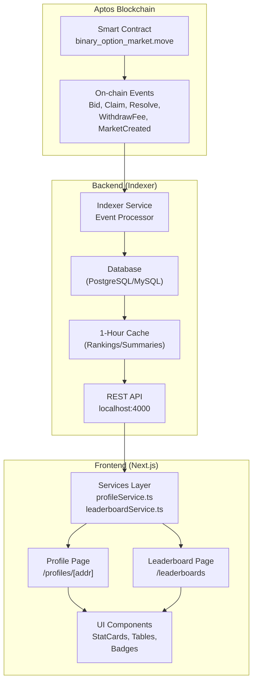

# System Design & Architecture

## Architecture Overview



### Key Components
- **Smart Contract**: Emits events for all user/market actions (no changes needed)
- **Indexer**: Processes events, computes aggregations, exposes via REST API
- **Frontend Services**: Fetch and transform data from indexer API
- **UI Components**: PolyMarket-inspired dark theme components (Chakra UI)

---

## Data Models

### Profile Data Model (expanded)

```typescript
interface ProfileData {
  user_addr: string;

  // === All-time Totals ===
  totals: {
    bet: { raw: string; human: string };       // Total wagered
    winning: { raw: string; human: string };    // Total won (claim amounts)
    owner_fee: { raw: string; human: string };  // Total fees earned as owner
    pnl: { raw: string; human: string };        // Net P&L (winning - bet)
  };

  // === Counts ===
  counts: {
    played: number;   // Markets participated in
    created: number;   // Markets created as owner
    won: number;       // Markets won
    lost: number;      // Markets lost (resolved, had bid, didn't win)
  };

  // === Derived ===
  win_rate: number;    // won / played * 100
  roi: number;         // pnl / bet * 100

  // === Monthly Summary (current month) ===
  monthly: {
    month: string;     // "2026-04" (YYYY-MM)
    bet: { raw: string; human: string };
    winning: { raw: string; human: string };
    pnl: { raw: string; human: string };
    is_profitable: boolean;  // pnl > 0
    played: number;
    won: number;
    win_rate: number;
  };
}
```

### Betting History Model

```typescript
interface BettingHistoryEntry {
  market_addr: string;
  pair_name: string;           // e.g., "BTC/USD"
  prediction: 'LONG' | 'SHORT';
  bet_amount: { raw: string; human: string };
  claim_amount: { raw: string; human: string };  // 0 if lost
  pnl: { raw: string; human: string };           // claim - bet
  won: boolean;
  market_result: 'LONG_WIN' | 'SHORT_WIN' | 'PENDING';
  strike_price: string;
  final_price: string;
  bet_time: string;            // ISO timestamp
  resolve_time: string;        // ISO timestamp or null
  status: 'active' | 'won' | 'lost' | 'pending';  // pending = not yet resolved
}

interface BettingHistoryResponse {
  entries: BettingHistoryEntry[];
  total: number;
  page: number;
  limit: number;
}
```

### Leaderboard Data Models

```typescript
// Common leaderboard entry structure
interface LeaderboardEntry {
  rank: number;
  user_addr: string;
  // Fields vary by category:
}

// 1. Most Profitable (by P&L)
interface ProfitLeaderEntry extends LeaderboardEntry {
  pnl: { raw: string; human: string };
  volume: { raw: string; human: string };       // tiebreaker
  win_rate: number;
  markets_played: number;
}

// 2. Highest Volume (by total wagered)
interface VolumeLeaderEntry extends LeaderboardEntry {
  volume: { raw: string; human: string };
  pnl: { raw: string; human: string };
  markets_played: number;
}

// 3. Top Market Owners (by participant count)
interface OwnerParticipantsEntry extends LeaderboardEntry {
  total_participants: number;        // distinct users across all owned markets
  markets_created: number;
  total_pool: { raw: string; human: string };
  fee_earned: { raw: string; human: string };
}

// 4. Largest Pools (by total pool volume)
interface OwnerPoolEntry extends LeaderboardEntry {
  total_pool: { raw: string; human: string };
  markets_created: number;
  total_participants: number;
  fee_earned: { raw: string; human: string };
}

// Time range enum
type TimeRange = 'today' | 'weekly' | 'monthly' | 'alltime';

// Leaderboard response
interface LeaderboardResponse {
  category: 'profit' | 'volume' | 'owner_participants' | 'owner_pools';
  time_range: TimeRange;
  last_updated: string;           // ISO timestamp (updated hourly)
  entries: LeaderboardEntry[];
  total: number;
}

### Indexer Database Schema (Proposed)

We use a relational database (PostgreSQL or MySQL) to track events and compute P&L.

```sql
-- Track all markets created
CREATE TABLE markets (
    market_addr VARCHAR(66) PRIMARY KEY,
    creator_addr VARCHAR(66) NOT NULL,
    pair_name VARCHAR(20) NOT NULL,
    strike_price VARCHAR(40),
    created_at TIMESTAMP WITH TIME ZONE DEFAULT CURRENT_TIMESTAMP,
    resolved_at TIMESTAMP WITH TIME ZONE,
    result VARCHAR(10) -- 'LONG_WIN', 'SHORT_WIN', etc.
);

-- Track all bids (bets)
CREATE TABLE bids (
    id SERIAL PRIMARY KEY,
    market_addr VARCHAR(66) REFERENCES markets(market_addr),
    user_addr VARCHAR(66) NOT NULL,
    amount_raw BIGINT NOT NULL,
    prediction VARCHAR(10) NOT NULL, -- 'LONG' or 'SHORT'
    tx_hash VARCHAR(66) NOT NULL,
    timestamp TIMESTAMP WITH TIME ZONE NOT NULL
);

-- Track all claims (winnings)
CREATE TABLE claims (
    id SERIAL PRIMARY KEY,
    market_addr VARCHAR(66) REFERENCES markets(market_addr),
    user_addr VARCHAR(66) NOT NULL,
    amount_raw BIGINT NOT NULL,
    claimed_at TIMESTAMP WITH TIME ZONE NOT NULL,
    tx_hash VARCHAR(66) NOT NULL
);

-- Pre-computed Leaderboard Cache (Updated Hourly)
CREATE TABLE leaderboard_snapshots (
    id SERIAL PRIMARY KEY,
    category VARCHAR(20) NOT NULL, -- 'profit', 'volume', etc.
    time_range VARCHAR(10) NOT NULL, -- 'daily', 'weekly', etc.
    data JSONB NOT NULL, -- The cached LeaderboardResponse
    computed_at TIMESTAMP WITH TIME ZONE DEFAULT CURRENT_TIMESTAMP
);
```
```

---

## API Design

### New/Modified Indexer Endpoints

#### Profile Endpoints

| Method | Endpoint | Description |
|--------|----------|-------------|
| GET | `/profiles/{addr}` | Get profile summary (MODIFY: add pnl, monthly, roi, lost count) |
| GET | `/profiles/{addr}/history` | Get betting history with pagination |
| GET | `/profiles/{addr}/monthly?ym={YYYY-MM}` | Get monthly performance breakdown |
| GET | `/profiles/{addr}/activity?limit={n}` | Existing activity feed (keep as-is) |

##### `GET /profiles/{addr}` — Enhanced Response
```json
{
  "user_addr": "0x...",
  "totals": {
    "bet": { "raw": "5000000000", "human": "50.0" },
    "winning": { "raw": "7500000000", "human": "75.0" },
    "owner_fee": { "raw": "200000000", "human": "2.0" },
    "pnl": { "raw": "2500000000", "human": "25.0" }
  },
  "counts": {
    "played": 15,
    "created": 3,
    "won": 9,
    "lost": 4
  },
  "win_rate": 60.0,
  "roi": 50.0,
  "monthly": {
    "month": "2026-04",
    "bet": { "raw": "1000000000", "human": "10.0" },
    "winning": { "raw": "1500000000", "human": "15.0" },
    "pnl": { "raw": "500000000", "human": "5.0" },
    "is_profitable": true,
    "played": 4,
    "won": 3,
    "win_rate": 75.0
  }
}
```

##### `GET /profiles/{addr}/history?page=1&limit=20` — New Endpoint
```json
{
  "entries": [
    {
      "market_addr": "0x...",
      "pair_name": "BTC/USD",
      "prediction": "LONG",
      "bet_amount": { "raw": "100000000", "human": "1.0" },
      "claim_amount": { "raw": "180000000", "human": "1.8" },
      "pnl": { "raw": "80000000", "human": "0.8" },
      "won": true,
      "market_result": "LONG_WIN",
      "strike_price": "65000",
      "final_price": "67500",
      "bet_time": "2026-03-15T10:30:00Z",
      "resolve_time": "2026-03-16T12:00:00Z",
      "status": "won"
    }
  ],
  "total": 15,
  "page": 1,
  "limit": 20
}
```

#### Leaderboard Endpoints

| Method | Endpoint | Description |
|--------|----------|-------------|
| GET | `/leaderboards/profit?range={range}&limit={n}` | Rank by P&L |
| GET | `/leaderboards/volume?range={range}&limit={n}` | Rank by wagered volume |
| GET | `/leaderboards/owners/participants?range={range}&limit={n}` | Rank owners by participants |
| GET | `/leaderboards/owners/pools?range={range}&limit={n}` | Rank owners by pool size |

`range` parameter: `today`, `weekly`, `monthly`, `alltime`

##### `GET /leaderboards/profit?range=monthly&limit=50` — Response
```json
{
  "category": "profit",
  "time_range": "monthly",
  "last_updated": "2026-04-06T15:00:00Z",
  "entries": [
    {
      "rank": 1,
      "user_addr": "0x...",
      "pnl": { "raw": "5000000000", "human": "50.0" },
      "volume": { "raw": "10000000000", "human": "100.0" },
      "win_rate": 80.0,
      "markets_played": 10
    }
  ],
  "total": 150
}
```

---

## Component Breakdown

### Profile Page Components

```
/profiles/[addr].tsx (Page)
├── ProfileHeader        — Avatar, address, copy button, external links
├── MonthlySnapshot      — Current month P&L row with large indicator (↑/↓)
├── PerformanceRow       — Large Typography metrics: Win Rate, ROI, Volume
├── StatsGrid            — 2-column grid of detailed stat cards
│   ├── BettorStats      — Markets bet, won, lost, volume, winnings
│   └── OwnerStats       — Markets created, fees earned, total participants
└── BettingHistory       — Paginated table of all market participations
    ├── HistoryFilters   — Status filter (All / Won / Lost / Active)
    └── HistoryTable     — Sortable table with Market (Sticky), Position, P&L, Status
```

### Leaderboard Page Components

```
/leaderboards.tsx (Page)
├── LeaderboardHeader    — Title, last updated timestamp, time range selector
├── TimeRangeSelector    — Toggle: Today | Weekly | Monthly | All-time
├── CategoryTabs         — Tabs for each ranking category
│   ├── ProfitTab        — Most profitable bettors
│   ├── VolumeTab        — Highest volume bettors
│   ├── OwnerParticipantsTab — Market owners by participants
│   └── OwnerPoolsTab   — Market owners by pool size
├── TopThreeHighlight    — Podium-style highlight for top 3 in selected tab
└── LeaderboardTable     — Ranked list with badges, stats, and profile links
```

### Shared Components

```
/components/shared/
├── RankBadge            — 🥇🥈🥉 or #N badge
├── PnlIndicator         — Green ↑ or Red ↓ with value
├── AddressLink          — Shortened address with link to profile
├── StatCard             — Reusable stat display card
└── PaginationControls   — Page navigation for tables
```

---

## Design Decisions

### 1. PolyMarket-Inspired Dark Theme
- Maintain existing dark theme (`#0A0B0F` background)
- Use data-dense layout similar to financial dashboards
- Gradient accents for headers (blue → purple, matching OREKA branding)
- Professional typography with monospace for addresses/numbers

### 2. Indexer-First Architecture with 1-Hour Cache
- All heavy aggregation happens in the indexer DB via pre-computed views or scheduled tasks.
- Leaderboard snapshots are generated every 60 minutes to handle high traffic and prevent spam.
- API returns cached JSON immediately; indexer updates the cache in the background.

### 3. "Clear Numbers" Layout (No Charts)
- Replaces charts with high-visibility metrics (Large Font, meaningful colors).
- Focuses on P&L trend via textual and icon indicators (↑/↓).
- Performance Row highlights core "Smart Money" stats (Win Rate, ROI).

### 4. Professional Mobile Table Strategy
- Market Name column is "Sticky" on horizontal scroll.
- Professional data density maintained for power users.
- ISO timestamps converted to local device time in the UI.

### 4. Four Leaderboard Dimensions
- **Profit**: Identifies skilled traders (smart money)
- **Volume**: Identifies active participants (engagement)
- **Owner Participants**: Identifies popular market creators (community)
- **Owner Pools**: Identifies high-liquidity market creators (capital attraction)

### 5. Public Profiles
- All profiles are public (on-chain data is already public)
- No authentication required to view any profile
- Connected users see their own profile with the same layout

---

## Non-Functional Requirements

### Performance
- Profile page: Full render < 2 seconds
- Leaderboard page: Full render < 2 seconds
- Betting history: Paginated at 20 items, loaded on demand
- Indexer caches leaderboard data (recompute every 60 minutes)
- Client-side rate-limiting or debounce for profile queries to prevent abuse.

### Scalability
- Pagination for all list views
- Indexer uses database indexes on `user_addr`, `month`, `market_addr`
- Leaderboard pre-computation avoids expensive real-time queries

### Security
- No sensitive data — all data is on-chain and public
- API input validation for pagination and range parameters
- Address format validation before API calls

### Reliability
- Graceful error states for API failures
- Loading skeletons during data fetch
- Fallback to "No data" states instead of crashes
- Retry logic for transient API errors
