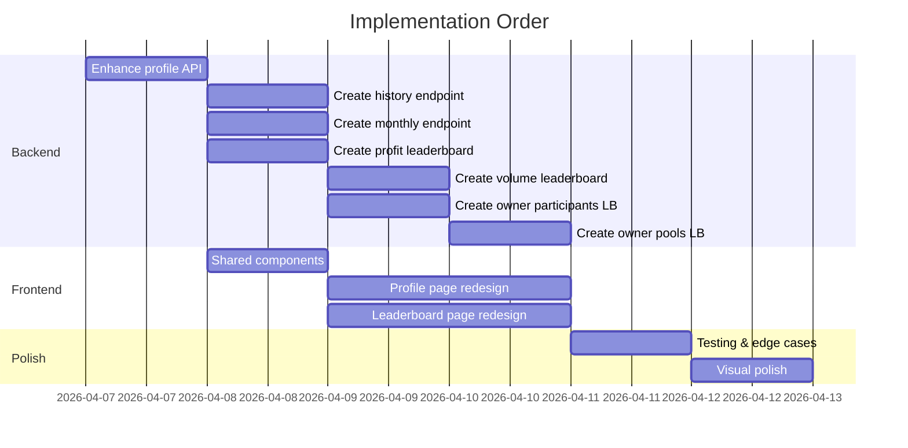

# Project Planning & Task Breakdown

## Milestones

- [x] **Milestone 1**: Backend — Indexer API enhancements (new endpoints + data enrichment)
- [x] **Milestone 2**: Frontend — Profile page redesign (UI + data integration)
- [x] **Milestone 3**: Frontend — Leaderboard page redesign (UI + data integration)
- [x] **Milestone 4**: Polish — Testing, optimization, and edge case handling

---

## Task Breakdown

### Phase 1: Backend — Indexer API Enhancements
> **Dependency**: None (can start immediately)
> **Estimated effort**: 6–8 hours

- [x] **Task 1.1**: Enhance `GET /profiles/{addr}` endpoint
  - [x] Add `pnl` field (winning - bet) to totals
  - [x] Add `lost` count (resolved markets where user had a bid but didn't win)
  - [x] Add `win_rate` (won / played × 100)
  - [x] Add `roi` (pnl / bet × 100)
  - [x] Add `monthly` object with current month's breakdown (bet, winning, pnl, is_profitable, played, won, win_rate)

- [x] **Task 1.2**: Create `GET /profiles/{addr}/history` endpoint
  - [x] Query all BidEvents for the user
  - [x] Join with market data (pair_name, strike_price, final_price, is_resolved, result)
  - [x] Join with ClaimEvents to determine win/loss and claim amount
  - [x] Compute pnl per entry (claim_amount - bet_amount)
  - [x] Support pagination (`page`, `limit` query params)
  - [x] Support status filter (`status=active|won|lost|pending`)
  - [x] Sort by bet_time descending (most recent first)

- [x] **Task 1.3**: Create `GET /profiles/{addr}/monthly` endpoint
  - [x] Accept `ym` query param (YYYY-MM format)
  - [x] Return month-specific stats: bet, winning, pnl, is_profitable, played, won, win_rate

- [x] **Task 1.4**: Create `GET /leaderboards/profit` endpoint
  - [x] Accept `range` (today/weekly/monthly/alltime) and `limit` query params
  - [x] Aggregate ClaimEvent amounts - BidEvent amounts per user within time range
  - [x] Return sorted list with pnl, volume, win_rate, markets_played
  - [x] Include `last_updated` timestamp

- [x] **Task 1.5**: Create `GET /leaderboards/volume` endpoint
  - [x] Accept `range` and `limit` query params
  - [x] Aggregate total BidEvent amounts per user within time range
  - [x] Return sorted list with volume, pnl, markets_played

- [x] **Task 1.6**: Create `GET /leaderboards/owners/participants` endpoint
  - [x] Accept `range` and `limit` query params
  - [x] For each market owner, count distinct bidders across their markets within time range
  - [x] Return sorted list with total_participants, markets_created, total_pool, fee_earned

- [x] **Task 1.7**: Create `GET /leaderboards/owners/pools` endpoint
  - [x] Accept `range` and `limit` query params
  - [x] For each market owner, sum total_amount across their markets within time range
  - [x] Return sorted list with total_pool, markets_created, total_participants, fee_earned

---

### Phase 2: Frontend — Profile Page Redesign
> **Dependency**: Phase 1 (Tasks 1.1, 1.2, 1.3)
> **Estimated effort**: 8–10 hours

- [x] **Task 2.1**: Create shared components
  - [x] `PnlIndicator` — Green ↑ / Red ↓ with formatted value
  - [x] `RankBadge` — 🥇🥈🥉 or #N badge (reusable)
  - [x] `AddressLink` — Shortened address with copy + link to profile
  - [x] `StatCard` — Reusable stat display with icon, label, value, subtitle
  - [x] `PaginationControls` — Page navigation component

- [x] **Task 2.2**: Redesign `ProfileHeader` section
  - [x] Gradient avatar with wallet initials
  - [x] Wallet address with copy button
  - [x] Permalink button
  - [x] Account summary badges (e.g., "Top 10 Trader", "Market Creator")

- [x] **Task 2.3**: Build `MonthlySnapshot` card
  - [x] Current month P&L with large PnlIndicator
  - [x] Month selector (to view different months)
  - [x] Mini stats: Markets played, win rate, volume for the month
  - [x] Visual indicator: green glow if profitable, red if not

- [x] **Task 2.4**: Redesign `StatsGrid` section
  - [x] **Bettor Stats column**: Markets bet, Markets won, Total volume, Total winnings, Win rate, ROI
  - [x] **Owner Stats column**: Markets created, Total fees earned, Total participants attracted
  - [x] Use StatCard components with gradient borders and icons
  - [x] PolyMarket-inspired data density

- [x] **Task 2.5**: Build `BettingHistory` section
  - [x] Fetch data from `/profiles/{addr}/history`
  - [x] Table columns: Market (pair), Position (Long/Short), Bet Amount, Outcome, P&L, Status, Date
  - [x] Status filter tabs: All / Won / Lost / Active / Pending
  - [x] Sortable columns (by amount, P&L, date)
  - [x] Pagination with PaginationControls
  - [x] Color-coded rows: green for wins, red for losses, neutral for pending
  - [x] Click row to navigate to market detail

- [x] **Task 2.6**: Integrate service layer
  - [x] Create `profileService.ts` with typed API calls
  - [x] Handle loading, error, and empty states
  - [x] Implement data caching (SWR or manual)

---

### Phase 3: Frontend — Leaderboard Page Redesign
> **Dependency**: Phase 1 (Tasks 1.4–1.7)
> **Estimated effort**: 6–8 hours

- [x] **Task 3.1**: Build `LeaderboardHeader` section
  - [x] Title with trophy icon
  - [x] "Last updated" timestamp with auto-refresh indicator
  - [x] Short description of what leaderboards show

- [x] **Task 3.2**: Build `TimeRangeSelector` component
  - [x] Toggle buttons: Today | This Week | This Month | All Time
  - [x] Active state styling (gradient underline)
  - [x] Triggers data refetch on change

- [x] **Task 3.3**: Build `TopThreeHighlight` component
  - [x] Podium-style display for top 3 in selected category
  - [x] 🥇 Gold card, 🥈 Silver card, 🥉 Bronze card
  - [x] Show key metric (P&L, volume, participants, or pool depending on tab)
  - [x] Avatar + address for each

- [x] **Task 3.4**: Build `CategoryTabs` with 4 tabs
  - [x] **Most Profitable** — ProfitLeaderTable
  - [x] **Highest Volume** — VolumeLeaderTable
  - [x] **Top Owners (Participants)** — OwnerParticipantsTable
  - [x] **Largest Pools** — OwnerPoolsTable

- [x] **Task 3.5**: Build individual leaderboard tables
  - [x] Rank badge (🥇🥈🥉 for top 3, #N for others)
  - [x] Address with link to profile
  - [x] Category-specific columns (see design doc)
  - [x] Hover highlight on rows
  - [x] Top 3 rows with gradient background emphasis

- [x] **Task 3.6**: Integrate service layer
  - [x] Create `leaderboardService.ts` with typed API calls for all 4 categories
  - [x] Handle time range switching and refetching
  - [x] Loading skeletons during fetch
  - [x] Error handling with retry

---

### Phase 4: Polish & Testing
> **Dependency**: Phases 2 & 3
> **Estimated effort**: 3–4 hours

- [x] **Task 4.1**: Responsive design verification
  - [x] Test on mobile viewport (320px–480px)
  - [x] Test on tablet viewport (768px)
  - [x] Test on desktop (1280px+)

- [x] **Task 4.2**: Edge case handling
  - [x] Empty wallet (no history)
  - [x] Wallet with only bets (no claims)
  - [x] Wallet with only created markets (no bets)
  - [x] Very long history (pagination stress)
  - [x] API timeout / error states

- [x] **Task 4.3**: Performance optimization
  - [x] Verify page load < 3 seconds
  - [x] Ensure no unnecessary refetches
  - [x] Implement loading skeletons
  - [x] Optimize bundle size (lazy-load chart components)

- [x] **Task 4.4**: Visual polish
  - [x] Consistent spacing and typography
  - [x] Hover animations and transitions
  - [x] Gradient accents and glassmorphism effects
  - [x] Final comparison with PolyMarket reference

---

## Dependencies

### Critical Path
1. Backend profile API enhancement → Frontend shared components → Profile page → Testing
2. Backend leaderboard APIs → Frontend leaderboard tabs → Testing

### External Dependencies
- Indexer service must be running and processing events
- Aptos fullnode must be accessible for event data
- No npm packages need to be added (Chakra UI + recharts already available)

---

## Timeline & Estimates

| Phase | Tasks | Estimated Hours | Priority |
|-------|-------|-----------------|----------|
| Phase 1: Backend | 7 tasks | 6–8 hours | 🔴 Critical |
| Phase 2: Profile Frontend | 6 tasks | 8–10 hours | 🔴 Critical |
| Phase 3: Leaderboard Frontend | 6 tasks | 6–8 hours | 🟡 High |
| Phase 4: Polish | 4 tasks | 3–4 hours | 🟢 Medium |
| **Total** | **23 tasks** | **23–30 hours** | |

---

## Risks & Mitigation

| Risk | Impact | Likelihood | Mitigation |
|------|--------|------------|------------|
| Indexer doesn't have all needed aggregation logic | High | Medium | Verify data availability early; implement aggregation in indexer first |
| Aptos fullnode rate limiting during development | Medium | High | Use indexer-first approach; cache aggressively |
| Complex monthly P&L calculation edge cases | Medium | Medium | Define clear rules: UTC+7 timezone, pending markets excluded from P&L |
| Large data sets slow down leaderboard | Low | Low | Enforce pagination, pre-compute rankings |
| Chakra UI layout inconsistencies | Low | Low | Test on multiple viewports during development |

---

## Resources Needed

### Technical
- Access to indexer source code (to add new endpoints)
- Aptos mainnet RPC access (already configured)
- Frontend dev server (already running)

### Knowledge
- Current indexer database schema and event processing logic
- Existing Chakra UI theme customization (`theme.ts`)
- PolyMarket UI reference for design inspiration

---

## Post-Implementation Verification (2026-04-07)

- [x] **Database Connectivity**: Fixed `api/.env` to use local `admin` user.
- [x] **Frontend Proxy**: Updated `frontend/next.config.js` to rewrite `/api/` to `localhost:4000`.
- [x] **Schema Alignment**: 
  - Aligned column names in `profiles.ts` and `leaderboards.ts` with actual `oreka_db` schema.
  - Reverted `amount_atomic` -> `amount_raw`.
  - Reverted `payout_atomic` -> `winning_raw`.
  - Reverted `market_id_text` -> `market_addr`.
- [x] **Error Resolution**: Fixed 500 Internal Server Errors on the Profile page.
- [x] **Functional Verification**: Verified `profiles/{addr}` and `profiles/{addr}/history` return valid JSON.

---

### Phase 5: Implementation Fixes (Post-Check)
> **Dependency**: Post-Implementation Verification
> **Estimated effort**: 2–3 hours

- [x] **Task 5.1**: Fix Database Schema Assumptions in Profile API (`api/src/routes/profiles.ts`)
  - [x] Remove or adjust the `AND m.is_resolved = false` filter in the history query so it doesn't crash on missing columns
  - [x] Adjust how `status` filtering works logically if `is_resolved` isn't physically in the database

- [x] **Task 5.2**: Add Missing Fields to Leaderboard API (`api/src/routes/leaderboards.ts`)
  - [x] Add `win_rate` to `/leaderboards/profit` endpoint
  - [x] Add `pnl` to `/leaderboards/volume` endpoint
  - [x] Add `fee_earned` to `/leaderboards/owners/*` endpoints

- [x] **Task 5.3**: Update Frontend Services and UI to Consume Full Data
  - [x] Update `LeaderboardEntry` interface in `leaderboardService.ts` to include missing fields
  - [x] Update `/leaderboards` page to cleanly display `win_rate`, `pnl`, and `fee_earned` where appropriate
  - [x] Fix profile API return structure in `api/src/routes/profiles.ts` to align `win_rate`, `roi`, and `lost_count` structure if necessary (Optional, depending on strictness of alignment).

---

### Phase 6: On-Chain User Stats (Option A)
> **Dependency**: Move Contract Deployment
> **Estimated effort**: 3 hours

- [x] **Task 6.1**: Modify `binary_option_market.move` to include Global `UserStatsRegistry`
  - [x] Add `UserStats` and `UserStatsRegistry` structs.
  - [x] Update `initialize_market_registry` to also initialize `UserStatsRegistry`.
  - [x] Update `bid` to record volume and markets played.
  - [x] Update `claim` to record winnings and markets won.
- [x] **Task 6.2**: Add View Functions for UserStats
  - [x] Add `get_user_stats(user: address)` to retrieve on-chain volume and winnings.
- [x] **Task 6.3**: Update Application to Use On-Chain Data
  - [x] Refactor the frontend or indexer to leverage this high-fidelity on-chain data for accuracy. Overlay `get_user_stats` on profile and leaderboard pages.

---

### Phase 7: Maintenance & Final Fixes (Post-Review)
> **Dependency**: Code Review (2026-04-07)
> **Estimated effort**: 4–6 hours

- [x] **Task 7.1**: Resolve Database Schema Mismatch (Add missing columns `final_price` and `resolution_outcome` to `markets` table)
- [x] **Task 7.2**: Implement Indexer Source Code (Restore/create `indexer/src/index.ts` to sync Aptos events (Bid, Claim, Resolve) to DB)
- [x] **Task 7.3**: Data-Driven UI (Replace hardcoded "Level 1", "Joined Date", "Top 10%" with dynamic values)

---

### Phase 8: Post-Launch Improvements & Documentation
> **Dependency**: Phase 3 (Leaderboard redesign)
> **Estimated effort**: 4–6 hours

- [x] **Task 8.1**: Redesign Leaderboard UI (Top 3 Podium Recognition)
  - [x] Implement enhanced 3D/Podium-style visual for Top 1, 2, 3.
  - [x] Add distinct colors (Gold, Silver, Bronze) and trophies.
  - [x] Include glow effects and professional typography for performers.
  - [x] Ensure responsiveness of the new podium layout.

- [x] **Task 8.2**: Create Comprehensive Project Documentation
  - [x] Create `DOCS.md` with operational info.
  - [x] Detail Smart Contract (Aptos/Move) functions and events.
  - [x] Document Backend Indexer and API infrastructure.
  - [x] Provide a User Guide for betting and market creation.
  - [x] Outline the project's technical architecture and roadmap.

- [x] **Task 8.3**: Final Review & Deployment Readiness
  - [x] Verify all UI components across screen sizes.
  - [x] Perform final cross-check with requirements and design docs.

